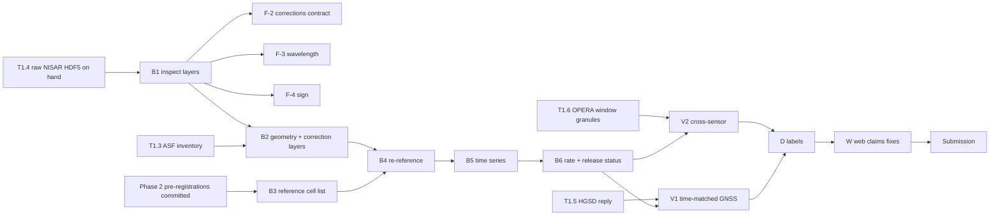

# TerraGauge execution plan after the audit (v1, 2026-11-10)

Audience: team members and the executing agent.

This plan sits under MASTER v3. MASTER says what to build and why. This plan says in what order, in which files, and what "done" means, corrected by the findings in `docs/audit/2026-11-10-codebase-audit.md` (IDs A1 to A25).

Where this plan and MASTER disagree on a fact, the audit evidence wins and the difference is logged as an erratum in `docs/decisions.md`. Owners are MASTER roles until `docs/team.md` names people.

## Rules carried from MASTER

- Test-first, small commits.
- Run `python3 -m unittest discover -s tests -v` in a Python 3.14 venv after every change.
- Pre-register before computing. No number ships without an artifact and a manifest. Claims policy (§20) applies to every string.

## Critical path

Three external dependencies decide the schedule:

1. Raw HDF5 in hand (T1.4).
2. The archive inventory (T1.3), which fixes the epoch count.
3. The HGSD reply (T1.5), which decides between V1 and the V3 fallback.

Start all three on Nov 10.

---

## Phase 0: repository baseline (Nov 10 to 11, about 2 hours, any member)

| ID | Task | Files | Done when |
|---|---|---|---|
| T0.1 | Commit `CLAUDE.md` and `MASTER.md` unchanged, so later pre-registrations can cite a commit that contains the rules (A18) | `CLAUDE.md`, `MASTER.md` | Hash recorded in `docs/decisions.md` |
| T0.2 | Pin Python 3.14 for ingestion (A16). Document why 3.15 fails (`h5py` has no wheel). Move `rasterio` and `earthaccess` into `requirements-layers.txt`, or document the skip as an optional dependency. Do not remove the test. | `README.md`, `requirements*.txt` | A clean 3.14 venv runs 48 tests with 0 errors; the skip is either cleared or documented |
| T0.3 | Create the MASTER §7 skeleton: `docs/decisions.md`, `docs/team.md`, `docs/ai-use.md`, `docs/rules/`, `docs/stakeholders/`, `docs/preregistration/`, `docs/worklog/` | `docs/` | `decisions.md` opens with errata E1 to E10 (audit §F), each dated |
| T0.4 | Freeze inputs: write a manifest of SHA-256 hashes for every committed `data/derived/` artifact that feeds any output | `data/manifests/input_freeze_2026-11-10.json`, small script | Re-running the script reproduces the file |

## Phase 1: external facts and governance (Nov 10 to 13, people)

| ID | Task | Owner | Output | Due |
|---|---|---|---|---|
| T1.1 | Ask the organizers in writing about pre-event work (G1) | Product lead | `docs/rules/pre-event-work.md` | Nov 12 |
| T1.2 | Ask the Local Lead about deck names **and** whether commit-author names in a public repo are acceptable (G3, A24). If not, the clean-repo fallback also uses neutral commit identities. | Product lead | `docs/rules/under-18.md` | Nov 12 |
| T1.3 | NISAR inventory (MASTER 6.2 Path A). Include SHA-256 and size for the five known granules (only one is recorded; A12). Record the collection `NISAR_L2_GUNW_PROVISIONAL_V1` and `P05023` (A22). Check Earthdata alerts. | Science lead | `data/manifests/nisar_track062_inventory_20261110.json`; decision entry | Nov 11 |
| T1.4 | Get the five raw GUNW HDF5 files onto the processing machine; they are not on the audit machine (A13). Verify SHA-256 against T1.3. If they cannot be found, re-download with an Earthdata login. Blocks B1, B2, F-2 extraction, and F-4. | Science lead | `data/raw/` (gitignored) | Nov 12 |
| T1.5 | Email HGSD and Fort Bend (MASTER 6.6 and §13). Request daily ENU in Houston20, the release ID, and continuity flags. Ask whether `PA##` sites are campaign occupations (A7). Ask the two stakeholder questions. | Validation lead | `docs/stakeholders/hgsd-data-request.md` | Nov 10 |
| T1.6 | Fetch the OPERA V2 inputs: F38238 granules with reference 2025-09-23 and secondaries 2025-11-10 to 2026-01-09 (6 granules, about 2.1 GB). Extend to 2026-03-22 (12 granules) if NISAR continues. Add a window mode to `scripts/fetch_opera_extension.py` or run a one-off command, and record SHA-256 hashes (the catalog has none). | Science lead | Pair artifacts plus manifest | Nov 13 |
| T1.7 | Save the official challenge statement (G2) | Product lead | `docs/rules/challenge-statement-2026.md` | Nov 13 |
| T1.8 | Locate `HoustonNet_2024_Data_Release.tgz` (its SHA-256 is in `data/manifests/houstonnet_2024.sha256`). It is needed for east and north components and daily series, because the summary has vertical rates only (A15). | Validation lead | Local archive, verified | Nov 12 |
| T1.9 | Name one owner for every MASTER §2 row and every task ID in this plan | Team | `docs/team.md` | Nov 11 |

## Phase 2: pre-registration package (draft Nov 11 to 12, commit by Nov 13)

All of it must be committed before any per-cell NISAR rate is computed. Write one file per item in `docs/preregistration/`, plus a machine-readable `config/preregistration.json` that the code reads, so values cannot drift silently. Record each commit hash in `docs/decisions.md`.

| ID | Decision | Recommendation |
|---|---|---|
| PR-1 | Release rule (MASTER 6.4) and the scope of rule (c) (A14) | Validate at two levels. **c1 (method):** the network passes V2, and V1 when available, under the PR-8 metrics. **c2 (cell):** a cell co-located with a validation point must agree within uncertainty. Cells with no co-located check are released only when c1 passes, and are labeled "method-validated, not cell-validated". Report results under both the strict rule and the validated rule. |
| PR-2 | Per-cell resolution test (A8) | Use a pooled per-epoch σ from the reference-region fit residuals, with a Student-t critical value at N−2 degrees of freedom (2.776 at N = 6). Report the expected chance count (cells × α) beside every label count. Keep MASTER's \|v\| ≥ 2σ_v as one sensitivity row. |
| PR-3 | Headline σ and planning wording (A3) | **Measured:** the pooled residual σ from PR-2. **Planning:** name the σ and give a range, 13 mm (2.2 yr, early 2028) to 18 mm (2.7 yr, mid-2028), stated as a lower bound. Retire the website's 8.2 mm / 1.6 yr figure. |
| PR-4 | Reference-region rule and frozen cell list (MASTER 6.3.2) | Region A: passes quality in every pair (coherence ≥ 0.4, valid ≥ 0.5, main connected component), and lies within 3 km of a continuous (non-campaign) HoustonNet station with ≥ 10 yr history and \|up\| ≤ 1 mm/yr. Exclude FEMA `OPEN WATER` cells and cells with OPERA water fraction > 0.5. The quality-only feasibility count is 175 cells, enough for ≥ 50. Region B: 5 km radius, or coherence ≥ 0.7. Freeze the cell IDs as a data file. |
| PR-5 | GNSS station split (A7) | Continuous stations only. Use HGSD's flag when it arrives; until then, use ≥ 0.5 samples/day. Re-split deterministically and record both lists. Stations that define the reference never count toward validation. |
| PR-6 | Corrections and ramp removal (A1) | Inventory each layer (ionosphere screen; wet and hydrostatic troposphere; solid-Earth tide) and apply each once. Choose a primary configuration after B1 and before B4. Run the sensitivity matrix: none / ionosphere / ionosphere + troposphere / all, each with and without ramp removal. |
| PR-7 | Labels: a complete partition with precedence (A14) | Insufficient Radar Evidence → Context Only (rate not released, or released but not resolved) → Review Mismatch (time-matched only) → Add Ground Monitoring (released, resolved, flood overlap, no GNSS within 2 km) → Investigate Satellite Signal (released, resolved, flood overlap, GNSS within 2 km). A released, resolved cell outside a flood polygon becomes Context Only, with that reason stated. |
| PR-8 | Validation metrics and pass thresholds (V1, V2, V3, C4) | Write them before computing. Agreement is median \|residual\| within the combined 2σ, plus the sign-agreement fraction; report n, exclusions, and the baseline. V2 window: OPERA dates fall 8 days after NISAR's, so compare linear trends over each product's own dates inside the common window. Project with each product's own look vector. |
| PR-9 | Sensitivity grid and label-change reporting (B7) | Coherence 0.3/0.4/0.5 × regions A/B × the PR-6 matrix. Report the percentage of labels that change. |

## Phase 3: correctness fixes, test-first (Nov 11 to 13)

★ marks steps that need the raw HDF5 from T1.4. Everything else is code-only and can land now.

| ID | Task | Files | Test |
|---|---|---|---|
| F-1 | FEMA null (A5): a cell with no matching polygon gets `flood_exposed: null`. Update the limitation text, regenerate the cell context and evidence artifacts, and log the before/after counts (207 cells). | `backend/ingestion/fema.py:223` | B8 "flood null never coerced" |
| F-2 | Correction-flag contract (A1). Every NISAR artifact gets `ionosphere_applied`, `troposphere_applied`, `tide_applied`, the source of each, and whether each array layer is present. The integrity gate rejects missing flags and any second application. In the same commit, replace `README.md:77`, `README.md:356`, and the `CLAUDE.md` sentence with the MASTER 4.4 wording. ★ for re-extraction only. | `nisar.py`, `quality.py`, README, CLAUDE.md | Double-application rejected; missing flags rejected |
| F-3 | Wavelength from metadata (A4): read and record the product's center frequency and wavelength; fix the README example | `nisar.py`, README | λ/(4π) = 19.255 mm/rad at 0.241962 m |
| F-4★ | LOS sign convention, taken from the GUNW specification and recorded in every NISAR artifact as `los_sign_convention`. Record OPERA's too ("positive = toward the satellite" is already stated). | `nisar.py` | Synthetic-ramp sign test (MASTER B4) |
| F-5 | Demo guard (A17): exporters and page or deck generators refuse any input whose `dataset_status` starts with `demonstration_only`; `/v1/summary` exposes `dataset_status` | `scripts/export_web.py`, `backend/service.py` | Demo input cannot produce a published file |
| F-6 | Detectability on invalid input (A21): raise `ValueError`, per MASTER B8, or record why a status return is safer. Either way, test it. | `backend/detection.py` | Fails loudly |
| F-7 | Planning-equation test: `rate_uncertainty_mm_year(18, 12, 6)` ≈ 131.0; the first N with 2σ_v ≤ 5 mm/yr is 84 | `tests/` | As stated |
| F-8 | Manifests (A12): SHA-256 and access date for the 4 missing NISAR granules, OPERA `20160712_20161016`, the FEMA overlay, and the extensometer table | `data/manifests/` | Ledger lists a checksum for every input |
| F-9 | Provisional traceability (A11): either add manifests, with the regeneration command and SHA-256, for every `data/derived/provisional/` file the website reads, including the gitignored ones, or stop the website reading them | `data/manifests/`, `export_web.py` | Every web number maps to a manifest |
| F-10 | Documentation cleanup (A25): fill or remove the empty "Next backend work" heading; replace "Remaining source work" item 2 (cross-pairs) with the release rule; define what the "~18 mm" in `CLAUDE.md` measures | README, CLAUDE.md | None (docs) |

## Phase 4: NISAR time series (event hours 0 to 16, MASTER §8)

| Step | Audit-specific instruction |
|---|---|
| B1★ | Run `inspect-h5` on each granule and save the layout to `data/derived/nisar_gunw_layout_<pair>.json`. Record: the phase-screen and lookup-table paths; the incidence, azimuth, or LOS unit-vector layers; the wavelength; the sign documentation; the product version; and the status of the January 2026 sample-data issues. |
| B2★ | Extend `nisar.py` to aggregate per-cell geometry and correction layers, then re-extract all five pairs. Keep the current artifacts for comparison; do not delete them. |
| B3 | Commit the PR-4 cell list. Its hash must come before any B4 output. |
| B4 | Re-reference each pair to the region median. `temporal.py` currently references to one cell (`_reference`, line 51); add region support and keep the raw values. |
| B5 | New module, for example `backend/ingestion/nisar_timeseries.py`: build cumulative series by chaining pairs. Continuity flags: main connected component and coherence in every pair, plus a flag on any step change near ±121 mm (one 2π cycle at this wavelength). |
| B6 | Per-cell least-squares rate: σ from residuals, σ_v, the pooled σ (PR-3), the PR-2 test, and the release status under both the strict and validated rules, with the failing part named. |
| B7 | PR-9 grid |
| B8 | MASTER B8 tests plus F-1 to F-7 |

Stated in advance: at N = 6 and σ between 13 and 18 mm, 2σ_v is about 185 to 260 mm/yr. No cell at Houston-scale rates is expected to resolve. A nonzero "resolved" count at this N should trigger an unwrapping and noise review before anything is labeled.

## Phase 5: validation (event hours 8 to 32, MASTER §9)

- **V2 first**, because its data is public (T1.6).
- **V1** if HGSD replies, using PR-5 stations and true ENU→LOS projection with the NISAR look vectors.
- **V3** only as a labeled fallback. The existing provisional OPERA–GPS check (105 stations, r = 0.66) must be re-run with the PR-5 split, per-product look vectors, and the reference frame recorded. Today it includes campaign stations and a fixed 38° angle.
- **C4** baseline: rank by radar magnitude alone.
- Output: `data/derived/validation_report_<date>.json`, with a manifest.

## Phase 6: decision logic (event hours 16 to 32, MASTER §10)

| ID | Task |
|---|---|
| D-1 | Implement the PR-7 labels and the PR-1 release rule in `backend/decision.py`. Every label carries: rule ID, thresholds, source values with units and dates, correction flags, validation status, and the limitation string. |
| D-2 | Keep the single-pair rule as a sensitivity function only. It is never exported. |
| D-3 | Replace `test_candidate_without_flood_context_is_still_investigated` and `test_missing_flood_context_does_not_hide_candidate` (A19). Log this in `docs/decisions.md` as a rule replacement under MASTER 5.2, not a weakened test. Add tests for: quality-OK but unreleased; flood overlap with no GNSS; released with GNSS nearby; released and resolved outside a flood polygon. |
| D-4 | Write `data/derived/terragauge_decisions_<date>.json` with a rule trace for every cell, plus a manifest |

## Phase 7: website claims fixes, no redesign (event hours 24 to 40)

| ID | Task |
|---|---|
| W-1 | Rebuild the web data only from manifest-tracked artifacts. The current `meta.json` is stale (A10). |
| W-2 | Delete the Future view and every projection: the `future` field and forecast block in `export_web.py`, the year selector in `App.tsx`, the projected range in `Card.tsx`, and the backtest section in `Pages.tsx`. MASTER §0.7: delete rather than soften. |
| W-3 | Rewrite every affirmative motion string (`insights.py:150-158`, `labels.ts`, `App.tsx`, `Card.tsx`, `Pages.tsx`) using the allowed phrasing (relative LOS displacement over a stated window). Stop presenting LOS→vertical as measured vertical motion. |
| W-4 | Replace the Urgent/High/Watch/Stable/Check classes with the PR-7 labels and their rule trace. This is a copy and data change only; the layout stays. |
| W-5 | Replace the NISAR "too few passes" lines and the 1.6-year figure with the PR-3 headline |
| W-6 | Re-run the G2 sweep, excluding the evidence quotes in `docs/audit/`. Target: zero hits. |

## Phase 8: submission (Nov 14 to 15, event hours 32 to 48, MASTER §14)

Unchanged from MASTER, with two additions:

- `docs/reproduce.md` must regenerate the headline from committed inputs in a clean Python 3.14 venv.
- The page's NASA-data section states the provisional collection and version (A22).

## Decisions needed from people

| # | Decision | Recommendation | Needed by |
|---|---|---|---|
| 1 | Scope of release rule (c) | Two-level validation (PR-1) | Nov 12 |
| 2 | Per-cell significance test | Pooled σ with a Student-t critical value (PR-2) | Nov 12 |
| 3 | Label for a released, resolved cell outside a flood polygon | Context Only, with the reason stated (PR-7) | Nov 12 |
| 4 | Primary correction and ramp-removal configuration | Decide after B1 and before B4; keep the alternative as a sensitivity row | Event hour 2 |
| 5 | Edit MASTER, or log errata | Log errata E1 to E10 in `docs/decisions.md`; bump MASTER to v3.1 only for the wavelength and the label count | Nov 11 |
| 6 | Commit identities in a public repo (G3) | Ask the Local Lead (T1.2) | Nov 12 |
| 7 | Who holds the raw NISAR HDF5 and the HoustonNet archive | Name the person in `docs/team.md` today | Nov 10 |

## Risks added by the audit (append to MASTER §19)

| Risk | Effect | Mitigation | Owner |
|---|---|---|---|
| Raw HDF5 not available on Nov 12 | B1 and B2 blocked; corrections and geometry stay unknown | T1.4 starts Nov 10; re-download path ready | Science lead |
| Campaign stations used in validation | Biased V1/V3 agreement | PR-5 | Validation lead |
| Chance "resolved" cells at N = 6 | Spurious labels | PR-2; report the chance count | Science lead |
| Stale or untraceable web numbers | Breaks MASTER §0.3; judges see figures that no artifact backs | F-9, W-1 | Product lead |
| Sign or geometry mismatch | V1 and V2 agreement flips | F-4, B2, PR-8 | Science lead |
